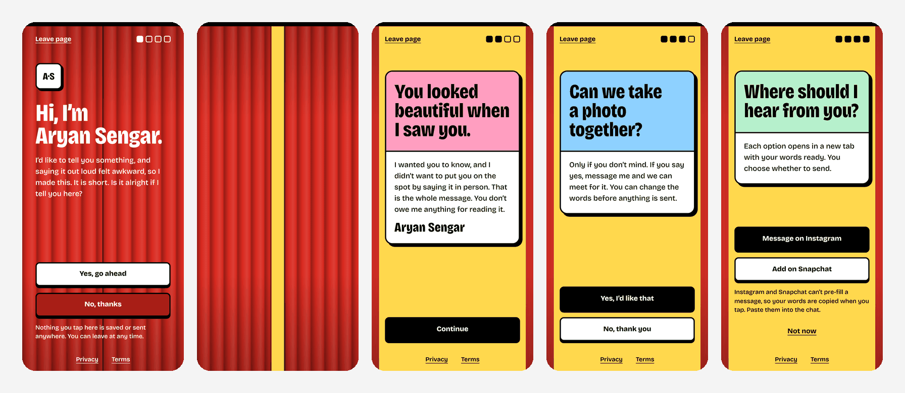
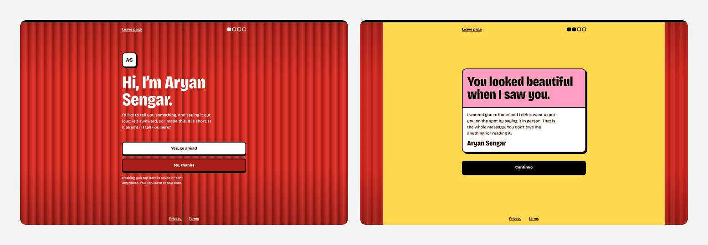

<div align="center">

<!-- ╔══════════════════════════════════════════════════════════════╗ -->
<!--                   ANIMATED WAVE HEADER                         -->
<!-- ╚══════════════════════════════════════════════════════════════╝ -->


<!-- ╔══════════════════════════════════════════════════════════════╗ -->
<!--                  ANIMATED TYPING TAGLINE                       -->
<!-- ╚══════════════════════════════════════════════════════════════╝ -->


<br/>

<!-- ╔══════════════════════════════════════════════════════════════╗ -->
<!--                      CTA BUTTONS                               -->
<!-- ╚══════════════════════════════════════════════════════════════╝ -->

[](https://YOUR-SITE.netlify.app/)
[](https://aryan-sengar-portfolio-v2.netlify.app/)

<br/>

<!-- ╔══════════════════════════════════════════════════════════════╗ -->
<!--               ANIMATED SKILL / TECH ICON BADGES                -->
<!-- ╚══════════════════════════════════════════════════════════════╝ -->


<br/><br/>


</div>

<br/>

<!-- ━━━━━━━━━━━━━━━━━━━━━━━━━━━━ WAVE DIVIDER ━━━━━━━━━━━━━━━━━━━━━━━━━━━━ -->


<br/>

<!-- ╔══════════════════════════════════════════════════════════════╗ -->
<!--                      SITE PREVIEW                              -->
<!-- ╚══════════════════════════════════════════════════════════════╝ -->

<div align="center">

[](https://YOUR-SITE.netlify.app/)

*On a phone, left to right: the closed curtain, the curtain opening, the message, the photo question, and the reply options ↑*

<br/>

[](https://YOUR-SITE.netlify.app/)

*On a laptop, the same booth sits between the pulled-aside curtains ↑*

</div>

<br/>

<!-- ━━━━━━━━━━━━━━━━━━━━━━━━━━━━ WAVE DIVIDER ━━━━━━━━━━━━━━━━━━━━━━━━━━━━ -->


<br/>

<!-- ╔══════════════════════════════════════════════════════════════╗ -->
<!--                     ABOUT THE PROJECT                          -->
<!-- ╚══════════════════════════════════════════════════════════════╝ -->

## 📸 About The Project

**Note 4 You** is a small, private web page for saying something kind to someone when saying it out loud feels awkward. It is built with plain **HTML**, **CSS** and **JavaScript**, with no frameworks and no build step.

This is **version 2**, a complete redesign built as a **photo booth**. The page is meant to be opened from a **QR code**. It starts behind a closed red velvet curtain and asks one question first: *is it alright if I tell you here?* Only if the answer is yes does the curtain pull aside and the message appear on a bright stage. The reader can then choose to take a photo together and reply, or simply leave. Nothing is stored, nothing is tracked, and every screen has a way out.

> 🤝 Built around one idea: the other person is always in control. Ask first, keep Yes and No equal, and never make leaving feel like a decision.

> 💌 Looking for the first edition with the airmail envelope? It lives in [Note-4-You](https://github.com/aryansengar007/Note-4-You).

<br/>

<div align="center">

| 🎨 Design | ⚡ Motion | 📱 Mobile First | 🔒 Privacy |
|:---:|:---:|:---:|:---:|
| Red curtain, butter stage, photo-frame screens | One curtain-opening moment, nothing else | Designed for phones, tested on laptops | No cookies, no analytics, no outside requests |

</div>

<br/>

<!-- ━━━━━━━━━━━━━━━━━━━━━━━━━━━━ WAVE DIVIDER ━━━━━━━━━━━━━━━━━━━━━━━━━━━━ -->


<br/>

<!-- ╔══════════════════════════════════════════════════════════════╗ -->
<!--                        FEATURES                                -->
<!-- ╚══════════════════════════════════════════════════════════════╝ -->

## ✨ Features

<br/>

| 🎨 UI & Design | ⚙️ Functionality | 📱 UX & Responsiveness |
|:---|:---|:---|
| Photo-booth concept with a pleated velvet curtain | Consent-first flow: asks before showing anything | Mobile-first layout, checked at 360, 390 and 1440 px |
| **Bricolage Grotesque**, one variable font, heavy condensed headlines | Curtain pulls open on Yes and stays closed on No | Buttons are 58 px tall, every tap target is at least 44 px |
| Red, butter yellow, pink, sky and mint palette | Message appears in short beats so it reads in order | "Leave page" link on every screen |
| Photo-frame screens: coloured picture area, white caption strip | Photo request with equal-weight Yes and No | Respects the reduced-motion setting, the curtain opens instantly |
| Four small frames fill up like a photo strip to show progress | Pre-written reply the reader can edit before sending | Visible keyboard focus, focus moves to each new heading |
| Buttons press down like a real booth button | WhatsApp and email open with the words filled in | Safe-area padding for notched phones |
| Strong contrast: white on red 4.9:1, black on yellow 15:1 | Instagram and Snapchat get the words copied for pasting | Short-phone layout keeps both buttons on screen |
| Favicon is a tiny curtain | Contact options appear only if you fill them in | Curtain and screen entrances animate only transform and opacity |
| Privacy and Terms pages styled to match | Taps during the opening animation are ignored | Loads only files from its own folder |
| No images, no icon fonts | Strict Content Security Policy and no-referrer headers | Fast first load, about 56 KB zipped |

<br/>

### 📌 The Flow

```
Closed curtain  ("Is it alright if I tell you here?")
   │
   ├── No  ──▶ "Understood." The curtain stays closed (can be undone)
   │
   └── Yes ──▶ Curtain pulls aside ──▶ The message
                                          │
                              "Can we take a photo together?"
                                          │
                                          ├── No  ──▶ Thank you, done
                                          │
                                          └── Yes ──▶ Instagram / Snapchat
                                                      (reply already written)
```

<br/>

<!-- ━━━━━━━━━━━━━━━━━━━━━━━━━━━━ WAVE DIVIDER ━━━━━━━━━━━━━━━━━━━━━━━━━━━━ -->


<br/>

<!-- ╔══════════════════════════════════════════════════════════════╗ -->
<!--                        TECH STACK                              -->
<!-- ╚══════════════════════════════════════════════════════════════╝ -->

## 🛠️ Tech Stack

<br/>

<div align="center">


<br/><br/>

| Layer | Technology | Purpose |
|:---:|:---|:---|
| 🧱 **Markup** | HTML5 | Semantic structure, one section per step |
| 🎨 **Styling** | CSS3 | Custom properties, repeating gradients for the velvet, `scaleX` curtain, hard-edged shadows |
| ⚡ **Logic** | Vanilla JavaScript | Step flow, curtain timing, config handling, clipboard, no libraries |
| 🔤 **Font** | [Bricolage Grotesque](https://fontsource.org/fonts/bricolage-grotesque) via [Fontsource](https://fontsource.org/) | One self-hosted `woff2`, trimmed to about 42 KB, no request to Google |
| ✂️ **Font Tooling** | [fontTools](https://github.com/fonttools/fonttools) | Limited the weight and width range and kept only the characters the site uses |
| 🛡️ **Security** | `_headers` file | CSP, `no-referrer`, no framing, `nosniff` |
| 🧪 **Testing** | [Playwright](https://playwright.dev/) | Screenshots at three sizes and a full-flow check |
| 🚀 **Deployment** | [Netlify](https://www.netlify.com/) | Static hosting |

</div>

<br/>

<!-- ━━━━━━━━━━━━━━━━━━━━━━━━━━━━ WAVE DIVIDER ━━━━━━━━━━━━━━━━━━━━━━━━━━━━ -->


<br/>

<!-- ╔══════════════════════════════════════════════════════════════╗ -->
<!--                     PROJECT STRUCTURE                          -->
<!-- ╚══════════════════════════════════════════════════════════════╝ -->

## 📁 Project Structure

```
Note-4-You-v2/
│
├── 📄 index.html                       ← The note: curtain, message, photo question, contact
├── 🎨 style.css                        ← All styles, curtain, photo frames, responsive rules
├── 🧠 app.js                           ← Step flow, curtain timing, contact buttons, clipboard
├── ⚙️  config.js                       ← Your handles, wording and reply text (edit this)
├── 🔒 privacy.html                     ← Privacy page
├── 📜 terms.html                       ← Terms page
├── 🔗 legal.js                         ← Adds your contact line to the legal pages
├── 🛡️  _headers                        ← Netlify security headers
├── 🖼️  favicon.svg                     ← Browser tab icon (a tiny curtain)
├── 🖼️  favicon-32.png                  ← Fallback tab icon
├── 🖼️  apple-touch-icon.png            ← Home screen icon
│
├── 📂 fonts/
│   └── bricolage-grotesque.woff2       ← The only font, headings and body
│
└── 📂 assets_readme/
    ├── hero.png                        ← Phone preview used in this README
    └── laptop.png                      ← Laptop preview used in this README
```

<br/>

<!-- ━━━━━━━━━━━━━━━━━━━━━━━━━━━━ WAVE DIVIDER ━━━━━━━━━━━━━━━━━━━━━━━━━━━━ -->


<br/>

<!-- ╔══════════════════════════════════════════════════════════════╗ -->
<!--                      GETTING STARTED                           -->
<!-- ╚══════════════════════════════════════════════════════════════╝ -->

## 🚀 Getting Started

**1. Clone the repository**

```bash
git clone https://github.com/aryansengar007/Note-4-You-v2.git
```

**2. Navigate into the project folder**

```bash
cd Note-4-You-v2
```

**3. Start a local server**

```bash
python3 -m http.server 8000
```

**4. Open the page**

```
http://localhost:8000
```

> ✅ There is no build step and nothing to install. Any static file server works, for example `npx serve`.

**5. Deploy**

Drag the folder onto Netlify, or connect this repository. The `_headers` file is picked up automatically.

<br/>

### ⚙️ Configuration

Everything you may want to change is in `config.js`. You never need to edit `app.js`.

| Setting | What it does |
|:---|:---|
| `instagram` | Instagram username without the `@` |
| `snapchat` | Snapchat username |
| `whatsapp` | Number with country code, digits only. Empty means no button |
| `email` | Email address. Empty means no button |
| `message` | Title, body paragraphs and signature of the letter |
| `replies.photo` | Words pre-filled when the reader says yes to the photo |
| `exitUrl` | Where the "Leave page" link goes |

> 💡 A contact option appears only when it is filled in. If none are filled in, the page skips the reply steps and ends politely.

<br/>

<!-- ━━━━━━━━━━━━━━━━━━━━━━━━━━━━ WAVE DIVIDER ━━━━━━━━━━━━━━━━━━━━━━━━━━━━ -->


<br/>

<!-- ╔══════════════════════════════════════════════════════════════╗ -->
<!--                   DESIGN CHALLENGES                            -->
<!-- ╚══════════════════════════════════════════════════════════════╝ -->

## 🧩 Design Challenges & What I Learned

| 🐛 Challenge | ✅ Resolution |
|:---|:---|
| Curtain folds turned into noise when the curtain gathered, because `scaleX` squeezes the pattern | Chose the gathered width per screen size so the folds stay readable on phones and laptops |
| Footer links overlapped the gap while the curtain was moving | Faded the top bar and footer out during the opening and back in once it settles |
| Text had to work on both red velvet and yellow stage | One foreground colour variable flips from white to black when the curtain opens, with contrast checked on every pairing |
| The signature appeared too early in the message sequence | Raised the selector specificity so its own delay wins over the paragraph rule |
| On laptops the Continue button floated far below the card | Centred the content on wide screens so the buttons follow the card |
| Buttons fell below the fold on short phones | Hid the monogram sticker and tightened spacing under 700 px of height |
| The variable font was 78 KB | Limited the weight and width range and kept only needed characters, which brought it to about 42 KB |
| Instagram and Snapchat cannot pre-fill a message | Copy the reply to the clipboard on tap and tell the reader to paste it, while WhatsApp and email use pre-filled links |
| Stray taps during the opening animation | Added a busy flag, and reduced-motion users skip straight to the message |

> 💡 **Key takeaway:** A page about a sensitive moment is mostly about restraint. The curtain is the one big gesture, so everything around it stays quiet: no tracking, no pressure wording, no extra animation, and no way to make leaving feel hard.

<br/>

<!-- ━━━━━━━━━━━━━━━━━━━━━━━━━━━━ WAVE DIVIDER ━━━━━━━━━━━━━━━━━━━━━━━━━━━━ -->


<br/>

<!-- ╔══════════════════════════════════════════════════════════════╗ -->
<!--                    ACKNOWLEDGEMENTS                            -->
<!-- ╚══════════════════════════════════════════════════════════════╝ -->

## 🙌 Acknowledgements

- 🔤 Typography by [Bricolage Grotesque](https://fontsource.org/fonts/bricolage-grotesque), packaged by [Fontsource](https://fontsource.org/) under the SIL Open Font License
- ✂️ Font trimming with [fontTools](https://github.com/fonttools/fonttools)
- 🧪 Browser testing with [Playwright](https://playwright.dev/)

<br/>

<!-- ╔══════════════════════════════════════════════════════════════╗ -->
<!--                     AUTHOR & CONNECT                           -->
<!-- ╚══════════════════════════════════════════════════════════════╝ -->

## 👨‍💻 Author

<div align="center">

### Aryan Sengar

🎓 **B.Tech CSE (AI & ML)** &nbsp;|&nbsp; 🌍 Gurugram, India &nbsp;|&nbsp; Frontend Developer & UI Enthusiast

<br/>

[](https://www.linkedin.com/in/aryan-sengar-786b96290/)
[](https://github.com/aryansengar007)
[](https://aryan-sengar-portfolio-v2.netlify.app/)
[](https://leetcode.com/u/aryan_sengar007/)

</div>

<br/>

<!-- ╔══════════════════════════════════════════════════════════════╗ -->
<!--                   ANIMATED WAVE FOOTER                         -->
<!-- ╚══════════════════════════════════════════════════════════════╝ -->


<div align="center">

© 2026 **Aryan Sengar** | All Rights Reserved. Unauthorized copying is strictly prohibited.

<br/>

*If you found this project helpful or inspiring, consider leaving a* ⭐ *because it means a lot!*

</div>
